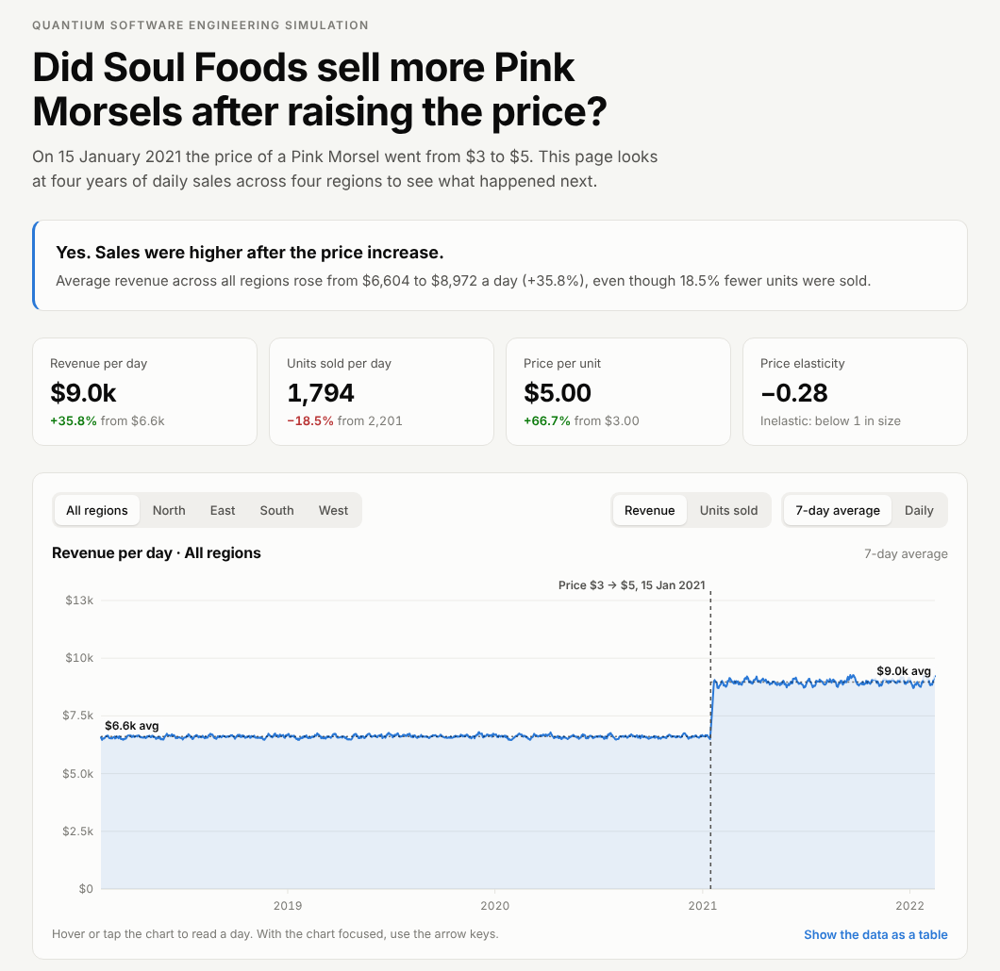

# Pink Morsel Sales Analysis

**Live site:** https://xiguahope1.github.io/quantium-sales-visualizer/

Did Soul Foods sell more Pink Morsels after raising the price? This project answers that with four years of daily sales data. It includes a Python data pipeline, a Dash dashboard with tests, and an interactive static website.

Built for the **Quantium Software Engineering Job Simulation** on Forage. Soul Foods is a fictional client.



## The answer

Yes. On 15 January 2021 the price went from $3 to $5.

| | Before | After | Change |
| :--- | ---: | ---: | ---: |
| Revenue per day | $6,604 | $8,972 | **+35.8%** |
| Units sold per day | 2,201 | 1,794 | −18.5% |
| Price per unit | $3.00 | $5.00 | +66.7% |

Customers bought fewer Pink Morsels, but the drop in units was far smaller than the rise in price. The price elasticity of demand is about −0.28, which means demand is inelastic. Revenue rose by roughly 35% in every region, so the effect came from the price change rather than one market.

## What's in the repo

```
├── data/                    Raw transaction CSVs (3 files, 7 products)
├── processed_data/          Cleaned Pink Morsel dataset used by app.py
├── docs/                    Static website served by GitHub Pages
│   ├── index.html           Page, chart and controls (plain JavaScript and SVG)
│   └── data.js              Daily revenue and units per region (generated)
├── data_processor.py        Cleans the raw data into processed_data/
├── build_site.py            Exports the cleaned data for the website
├── app.py                   Dash and Plotly dashboard with a region filter
├── test_app.py              Pytest suite for the dashboard
├── run_tests.sh             Runs the tests, exits 0 on pass and 1 on fail
└── requirements.txt
```

### 1. Data pipeline (`data_processor.py`)
- Combines the three raw sales files.
- Keeps only Pink Morsel rows. The match ignores case because the raw data spells it `pink morsel`.
- Strips the `$` from prices and computes `sales = quantity × price`.
- Writes one dataset with `sales`, `date` and `region` columns.

### 2. Dashboard (`app.py`)
- Dash and Plotly Express line chart of daily sales.
- Region filter: north, east, south, west or all.
- A marker line on the price change date.

### 3. Website (`docs/`)
- A single static page with no framework and no server.
- Region, revenue or units, and 7-day average or daily views.
- Hover or arrow keys to read any day, plus a monthly table view.
- Light and dark themes, and a mobile layout.

### 4. Tests (`test_app.py`, `run_tests.sh`)
- Check that the header, chart and region filter render.
- `run_tests.sh` returns a standard exit code so a CI runner can use it.

## Run it locally

```bash
git clone https://github.com/xiguahope1/quantium-sales-visualizer.git
cd quantium-sales-visualizer

python3 -m venv venv
source venv/bin/activate        # Windows: venv\Scripts\activate
pip install -r requirements.txt

python data_processor.py        # clean the data
python app.py                   # dashboard at http://127.0.0.1:8050/
bash run_tests.sh               # run the tests (needs Chrome and ChromeDriver)
```

To update the website after the data changes:

```bash
python build_site.py            # rewrites docs/data.js
python -m http.server           # then open http://localhost:8000/docs/
```

## Publish the website

1. Push the repo to GitHub.
2. Go to **Settings → Pages**.
3. Under **Build and deployment**, choose **Deploy from a branch**, then branch `main` and folder `/docs`.
4. The site goes live at `https://<your-username>.github.io/<repo-name>/` after a minute or two.

## Limitations and next steps
- This is a before/after comparison, so it can't separate the price effect from seasonality or other trends.
- A next step would be to compare the same months year-on-year or fit a model with seasonal terms.
  
## Tech stack

| Area | Tools |
| :--- | :--- |
| Language | Python, JavaScript, Bash |
| Data | Pandas |
| Dashboard | Dash, Plotly |
| Website | HTML, CSS, SVG, GitHub Pages |
| Testing | Pytest, dash[testing] |
